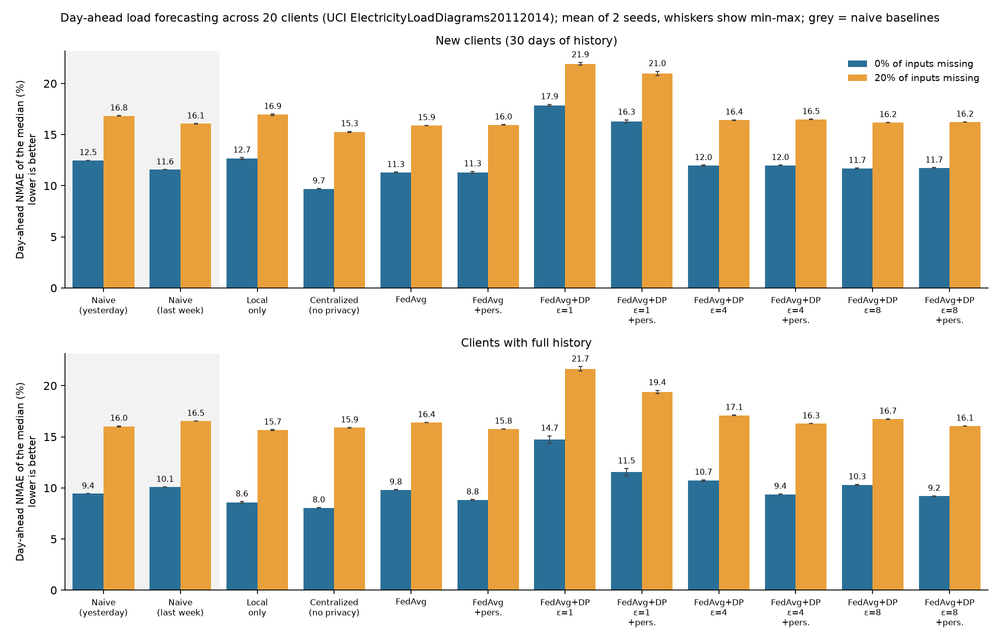
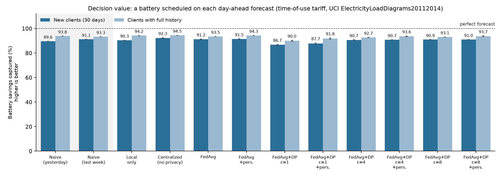
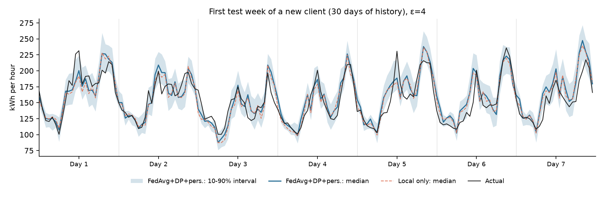
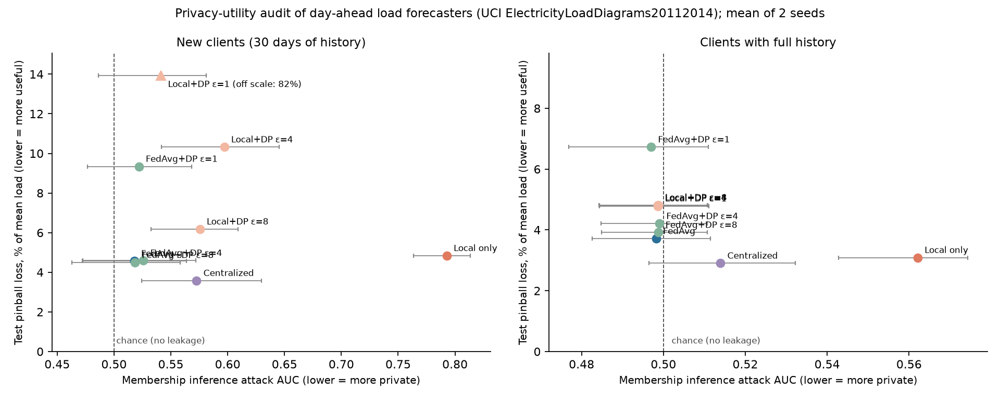
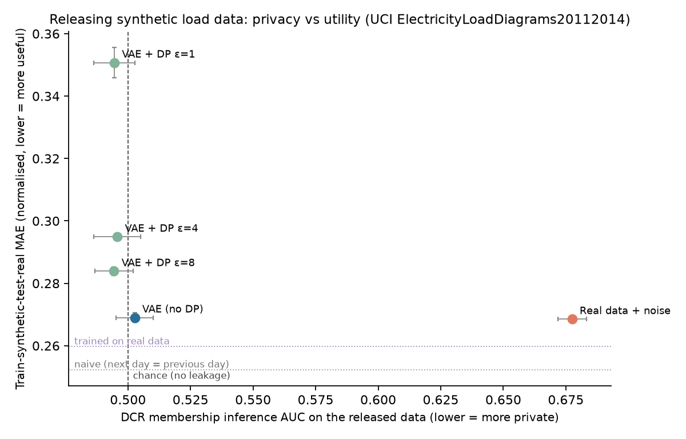

# Privacy-Preserving Federated Day-Ahead Load Forecasting, with a Battery-Scheduling Decision Layer

A small, reproducible study of **federated learning (FedAvg) with differential privacy (DP-SGD)** for **probabilistic day-ahead** electricity demand forecasting across many consumers, and of what the forecasts are worth when they drive a **decision**: scheduling a home battery under a time-of-use tariff.

Each consumer is a federated client. Raw consumption data never leaves the client; clients only share model weights, which can be trained under a formal (ε, δ)-DP guarantee.

The study asks four questions:

1. **Cold start.** Can a *new* member of an energy community, with only 30 days of history, get a good day-ahead forecast by learning with others, without seeing their data?
2. **Privacy cost.** How much accuracy does a formal guarantee cost, from ε = 1 to ε = 8?
3. **Uncertainty.** Are the predicted 10–90% intervals calibrated?
4. **Decision value.** How much of the savings a perfect forecast would bring does each forecast actually capture when it is used to schedule a battery?

## Setup

| Item | Choice |
|---|---|
| Data | [UCI ElectricityLoadDiagrams20112014](https://archive.ics.uci.edu/dataset/321/electricityloaddiagrams20112014): 370 Portuguese consumers, 15-min readings, resampled to hourly kWh, 2013–2014 |
| Clients | 20 consumers sampled at random from those active over the whole period; 50% are "new members" whose training inputs and targets all fall within their last 30 days (23 training days each) |
| Task | At midnight, forecast the 24 hourly loads of the next day as three quantiles (10%, 50%, 90%), from the past 7 days of hourly readings and calendar features of the target day |
| Split | Chronological: last 20% of days for testing (146 days) |
| Model | Residual over the weekly naive forecast: last week's profile plus a correction for each hour and quantile, predicted by an MLP (172 → 64 → 64 → 72) trained with the pinball (quantile) loss. The last layer starts at zero, so an untrained model equals the naive forecast. The model is kept small on purpose, since DP-SGD adds noise to every parameter's gradient |
| Seeds | 2 training seeds (initialisation, shuffling, DP noise, missing-data mask); same 20 clients; mean and min–max reported |

| Setting | What is shared | Notes |
|---|---|---|
| Naive (yesterday / last week) | nothing | forecast = the profile of 1 or 7 days earlier; standard references in load forecasting |
| Local only | nothing | each client learns alone |
| Centralized | all raw data | upper bound, not privacy-preserving |
| FedAvg | model weights | data stays local; same optimiser (SGD, momentum, gradient clipping) as the DP version |
| FedAvg + DP | model weights trained with DP-SGD (Opacus, RDP accountant) | record-level (ε, δ)-DP per client: one record = one training day; δ = 1/n |
| + pers. | nothing more | each client fine-tunes the global model on its own data; the personalised model never leaves the client |

**Metrics.** NMAE of the median forecast and pinball loss, both in % of the client's mean load; coverage of the 10–90% interval (target 80%).

**Decision layer.** Each client has a battery (capacity 8 h and power 2× its mean hourly load, 95% charge and discharge efficiency) and a time-of-use tariff (0.10 €/kWh 00–07 h, 0.32 €/kWh 18–22 h, 0.20 €/kWh otherwise). Every day, a linear programme plans charging and discharging on the median forecast (no export, state of charge back to 50% at midnight). The plan is applied to the actual load; energy discharged beyond actual demand is lost. The score is the share of the perfect-forecast savings that the plan captures.

## Run

```bash
pip install -r requirements.txt

# with the real data: download and unzip the UCI archive so LD2011_2014.txt sits here
python fl_energy.py

# without data (synthetic consumers with residential/office/industrial profiles)
python fl_energy.py --synthetic
```

It takes about 10–20 minutes on a laptop CPU. Outputs go to `results/`: `results.csv` (mean, min, max over seeds), `results_per_seed.csv`, `results.png` (accuracy), `battery.png` (decision value), `forecast_example.png` (one new client's first test week).

## Results

UCI data, 20 clients, mean of 2 seeds. NMAE and pinball loss in % of mean load (lower is better); coverage of the 10–90% interval (target 80%); battery savings captured in % of the perfect-forecast savings.

| Setting | NMAE new | Pinball new | Coverage new | NMAE full-history | Battery savings, new |
|---|---|---|---|---|---|
| Naive (yesterday) | 12.49 | 6.24 | – | 9.43 | 89.6 |
| Naive (last week) | 11.58 | 5.79 | – | 10.09 | 91.1 |
| Local only | 12.66 | 4.55 | 66.1 | 8.59 | 90.3 |
| Centralized (no privacy) | 9.70 | 3.40 | 72.1 | 8.05 | 92.3 |
| FedAvg + pers. | 11.30 | 4.24 | 67.9 | 8.82 | 91.5 |
| FedAvg + DP ε=1 + pers. | 16.29 | 5.43 | 75.0 | 11.55 | 87.7 |
| **FedAvg + DP ε=4 + pers.** | **11.99** | **4.34** | **72.6** | **9.37** | **90.7** |
| FedAvg + DP ε=8 + pers. | 11.75 | 4.30 | 72.2 | 9.19 | 91.0 |





**Findings**

- **Probabilistic forecasts are where federation pays off.** For new members with 23 training days, FedAvg cuts the pinball loss by 27% against the best naive reference (5.79% → 4.24%), and by 25% under ε=4 differential privacy (4.34%). Naive forecasts carry no uncertainty at all.
- **Point accuracy stays at the naive level.** The median forecast of the federated models matches last week's profile (11.3–12.0% vs 11.6% NMAE). With so little history, beating a strong seasonal reference on point accuracy is hard; the centralized upper bound (9.7%) shows that it is possible in principle.
- **Privacy cost is small at ε ≥ 4 and large at ε = 1.** With about 600 daily records per client, ε=1 raises the pinball loss of new members from 4.24% to 5.43%.
- **Intervals are slightly too narrow.** Coverage of the 10–90% interval is 68–75% instead of 80%, a gap that post-hoc calibration (e.g. conformal) could close.
- **Median-based scheduling hides forecast quality.** All settings except ε=1 capture about 90–92% of the perfect-forecast battery savings. A schedule built on the median alone cannot use the better uncertainty estimates, which motivates risk-aware scheduling on the quantiles.
- **Missing data.** With 20% of input readings missing, every setting degrades to about 16% NMAE, the level of the naive references.

## Privacy audit: membership inference

A formal ε says how much a model *may* leak; an attack measures how much it *does*. `mia.py` audits the forecasters empirically.

- **Setup.** Each client's training days are split at random into members (used for training) and held-out non-members from the same period. Every setting is retrained on the members only.
- **Attack.** A loss-threshold membership inference attack: a day is guessed to be a member when the model's pinball loss on it is low. Success is the AUC of telling members from non-members (0.5 = chance, 1.0 = perfect), averaged over clients.
- **Threat models.** The attacker sees the client's own model (local training), the shared global model (FedAvg), or, for FedAvg, each client's last local update, as an honest-but-curious server would.
- **Settings.** Local only, local + DP-SGD (ε = 1, 4, 8), centralized, FedAvg, FedAvg + DP-SGD (ε = 1, 4, 8).

```bash
python mia.py                                       # 2 seeds, about 15 minutes
python mia.py --seeds 0,1,2,3,4 --out results_5seeds   # the table below
python mia.py --seeds 0,1,2,3,4 --fl-lr 0.1 --out results_lr01   # step-size check for plain FedAvg
```

**Results (UCI, 20 clients, half of them new with 30 days of history; mean ± standard deviation over 5 seeds).** Members: 288 days per full client, 11 per new client.

| Setting | Attack AUC, full clients | Attack AUC, new clients | Client-update AUC, new | Test pinball, full | Test pinball, new |
|---|---|---|---|---|---|
| Local only | 0.562 ± 0.013 | **0.793 ± 0.024** | – | 3.09% | 4.84% |
| Local + DP, ε = 1 | 0.499 ± 0.013 | 0.541 ± 0.041 | – | 4.79% | 81.5% ± 11.5 |
| Local + DP, ε = 4 | 0.499 ± 0.013 | 0.597 ± 0.039 | – | 4.82% | 10.3% ± 0.9 |
| Local + DP, ε = 8 | 0.499 ± 0.013 | 0.575 ± 0.029 | – | 4.82% | 6.18% ± 0.30 |
| Centralized | 0.514 ± 0.014 | 0.573 ± 0.043 | – | 2.90% | 3.58% |
| FedAvg | 0.498 ± 0.013 | **0.518 ± 0.043** | 0.525 ± 0.042 | 3.72% | 4.57% ± 0.03 |
| FedAvg + DP, ε = 1 | 0.497 ± 0.014 | 0.522 ± 0.039 | 0.556 ± 0.030 | 6.73% | 9.34% ± 1.09 |
| FedAvg + DP, ε = 4 | 0.499 ± 0.013 | 0.526 ± 0.042 | 0.560 ± 0.034 | 4.21% | 4.59% ± 0.02 |
| FedAvg + DP, ε = 8 | 0.499 ± 0.012 | 0.518 ± 0.042 | 0.566 ± 0.041 | 3.92% | **4.49% ± 0.03** |



- **Data-poor clients leak most.** A new client's own model reveals which days it was trained on (AUC 0.79 ± 0.02), because 11 training days are easy to memorise. Full clients leak little (0.56).
- **Federation removes most of the leakage and helps accuracy.** The shared FedAvg model is close to chance for new clients (0.52 ± 0.04) and forecasts them better than their own local model (4.57% vs 4.84% pinball).
- **DP on its own is not enough for small clients.** Local DP-SGD lowers the attack but destroys the new clients' forecasts (81.5% pinball at ε = 1). Inside FedAvg, DP at ε = 8 keeps accuracy (4.49%), and ε = 4 costs almost nothing (4.59%).
- **The same ε does not mean the same protection.** For new clients, the updates a curious server sees leak slightly *more* with DP-SGD than without (0.566 vs 0.525 at ε = 8; higher in all 5 seeds). The DP runs use a larger step size (0.1 vs 0.05), so I re-ran plain FedAvg at 0.1 (`--fl-lr 0.1`): its update leakage rises only to 0.534 ± 0.040, and DP-SGD still leaks more in all 5 seeds (by 0.01 to 0.05, mean 0.03). The step size explains little of the gap; what remains differs only in DP-SGD's Poisson sampling and per-sample clipping, which behave differently on a client with 11 days. This does not contradict DP, since ε = 8 barely constrains a membership attack, but it shows that mechanism details change privacy for data-poor clients: the case for adaptive, per-client privacy.
- **Limits.** A loss-threshold attack is a lower bound: stronger attacks (e.g. shadow models, LiRA) could find more. With 11 member days, Poisson sampling sometimes draws an empty batch for a new client (Opacus warns about it); this is expected and does not affect the results.

## Releasing synthetic data: DP generative model and attack

Instead of sharing a model, a data holder may release synthetic data. `synth.py` tests this route.

- **Generator.** A variational autoencoder (Gaussian decoder with learned noise scale) learns pairs of consecutive days (previous day and next day, 48 hourly values), trained without DP and with DP-SGD (ε = 1, 4, 8).
- **Attack on the released data.** Distance-to-closest-record membership inference: real training days (members) and held-out days from the same period (non-members) are compared by their distance to the nearest synthetic record. AUC 0.5 = no leakage.
- **Utility.** Train on synthetic, test on real (TSTR): a ridge regression predicting the next day from the previous day, fitted on synthetic pairs and evaluated on real test pairs; plus hour-by-hour fidelity (mean 1-D Wasserstein distance).
- **Baseline.** Releasing the real records with Gaussian noise, a common naive anonymisation.

```bash
python synth.py      # about 5 minutes; writes results/synth.csv and results/synth.png
```

UCI data, 20 clients, mean of 2 seeds (TSTR MAE in normalised units; reference trained on the real member pairs: 0.260):

| Released data | Attack AUC | TSTR MAE | Utility loss vs real |
|---|---|---|---|
| Real data + Gaussian noise | **0.677** | 0.269 | +3% |
| VAE (no DP) | 0.503 | 0.269 | +3% |
| VAE + DP ε=8 | 0.494 | 0.284 | +9% |
| VAE + DP ε=4 | 0.496 | 0.295 | +13% |
| VAE + DP ε=1 | 0.495 | 0.351 | +35% |



- **Naive anonymisation leaks.** Releasing noisy real records lets the attack identify training days (AUC 0.68).
- **Generated data resists this attack, with or without DP.** The VAE keeps utility close to real data and the distance attack sees no leakage.
- **DP has a measurable utility cost.** From ε=8 to ε=1, the TSTR error grows from +9% to +35% over real data, while the measured leakage was already at chance level. The formal guarantee and the empirical risk diverge, which is the case for calibrating privacy adaptively with stronger attacks.
- **Strong persistence.** On this dataset, "next day = previous day" (MAE 0.252) is a very strong reference that the linear model does not beat, so utility is compared with the model trained on real data.

## Limitations

- **Attacks.** Both audits use simple attacks (loss threshold, distance to closest record). Stronger attacks such as likelihood-ratio attacks with shadow models may reveal more leakage, so the measured AUCs are lower bounds on risk.
- **Privacy unit.** DP protects one training day. Consecutive examples share input days, so the guarantee for a single hourly reading is weaker (group privacy). Client-level DP and secure aggregation are not implemented.
- **Scale.** Two seeds, 20 clients, light hyperparameter tuning on synthetic data only, no weather covariates.
- **Missing data.** Missing inputs are imputed with the client mean; the models are not trained to handle them.
- **Decision layer.** One tariff and one battery size per client; the schedule uses only the median forecast.

## Next steps

- Weather covariates and probabilistic calibration (e.g. conformal adjustment of the intervals).
- Decision-aware scheduling that uses the quantiles (risk-averse or stochastic optimisation), and decision-focused training.
- Coordination: a shared community battery or flexibility requests, where clients with competing objectives must agree on a schedule (distributed optimisation, game-theoretic mechanisms).
- Client-level DP, secure aggregation, and robustness to corrupted or adversarial clients.

## Author

Sungyeon Hong · [GitHub](https://github.com/syHong23) · [LinkedIn](https://www.linkedin.com/in/sungyeon-hong-809a59134/)
